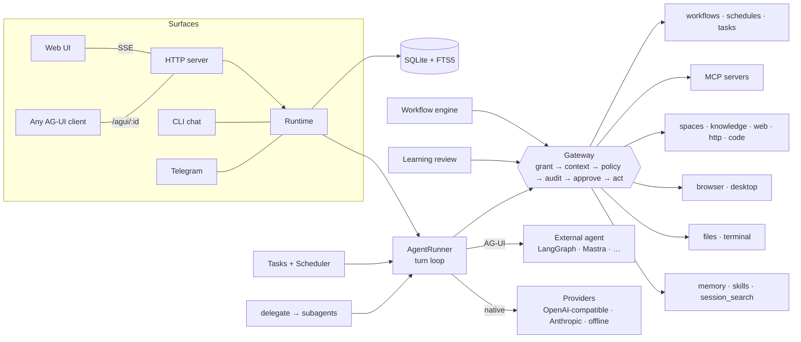

# Architecture



## The four invariants

1. **Every action goes through the gateway.** `Gateway.execute()` is the only caller of a tool's `run()`. In order, it:
   1. resolves the tool
   2. checks the coworker's grants
   3. resolves the server-side context (page host, the element behind a ref, whether a file exists, the program a shell command runs)
   4. evaluates the policy
   5. writes an audit row
   6. asks a human if the policy requires it
   7. runs the tool
   8. records the outcome

   That holds for chat, tasks, schedules, workflow nodes, subagents, MCP tools, external AG-UI agents and the learning loop.
2. **Policy fails closed.** Nothing is allowed unless an `allow` rule matches. `deny` beats `requireApproval`, which beats `allow`. A rule that throws (unknown field, type error) counts as *matched* for deny and approval, and as *unmatched* for allow. In `dry-run` mode the would-be decision is recorded and everything is allowed.
3. **The system prompt is frozen per conversation.** It is built once (role, coworker roster, workflows, skill index, memory snapshot) and stored on the thread. Memory and skill writes take effect in the *next* conversation, so the provider's prefix cache is never broken. Context compression is the one sanctioned exception.
4. **Interrupted work is never silently resumed.** A task that was running when the process died becomes `interrupted`. A person reviews its audit trail and presses *Retry after review*.

## Agent loop (`agent/runner.ts`)

```
ensure thread → frozen system prompt → history (+ summary) → user message
loop ≤ maxIterations:
  compress if over budget
  step()  — native provider OR external AG-UI agent, streaming AG-UI events
  persist assistant message (+ FTS index)
  no tool calls → done
  execute calls via gateway (read-only calls in parallel, others in order)
  persist tool results, emit TOOL_CALL_RESULT + tool_ui cards
→ RUN_FINISHED → maybe schedule learning review
```

Every run emits [AG-UI](https://docs.ag-ui.com) events, so the same stream feeds the web UI, the CLI, the Telegram adapter and any AG-UI client.

## Learning loop (`learning/`)

| Piece | Behaviour |
|---|---|
| `USER.md` | User profile shared by every coworker (2,000 chars). |
| `MEMORY.md` | Per-coworker notes (4,000 chars). |
| Entry scanning | Entries are scanned for prompt-injection phrases and credentials before they are saved. |
| Skills | `SKILL.md` folders (name + description frontmatter) in the agentskills.io / Claude skills format. The index goes into the prompt; bodies load on demand with `skill_view`. Learned skills live in `data/skills`. Patching a bundled skill forks it. Usage is counted. |
| Review | After a turn, a forked reviewer reads the transcript with only `memory`, `skill_manage` and `skill_view`, and saves what is worth keeping. Triggers: every *N* user turns, any turn with ≥ *M* tool calls, or an explicit preference ("I prefer…"). It runs through the gateway as `initiator = "review"`. |
| Recall | `session_search` uses FTS5 over every message, including compacted ones. |

## Workflows (`workflow/engine.ts`)

A workflow is a JSON DAG of typed nodes:

- **Edges** can carry a `sourceHandle` (an if/else case id, `else`, or `error`).
- **Execution** runs in waves: nodes whose predecessors are all resolved run in parallel. A node with no active incoming edge is *skipped*, and skips propagate down the branch.
- **Variables** — `{{node.field}}` interpolates. A string that is exactly one reference passes the raw value. `{"$expr": …}` evaluates an expression.
- **Error strategies** — per node `onError` (`fail` / `continue` / `branch`), plus `retries` with backoff.
- **Side effects** — `tool`, `http` (via the `http_request` tool), `code` (via `code_run`) and `agent` nodes all run as the workflow's coworker, through the gateway.
- **Workflows as tools** — `exposeAsTool` registers the workflow as `wf_<id>`, with parameters taken from its inputs.

## Computers (`computer/`)

- **Browser** — each coworker gets a persistent Playwright Chromium profile under `data/browser/<id>`, so its logins persist. Snapshots tag interactive elements with `data-cfx-ref` and print `[@eN] role "name"` lines. A person can take control from the Computer panel: clicks and keys are sent to the same page and audited as `initiator = user`.
- **Desktop** — the `agent-cu` CLI drives the accessibility tree, in the same snapshot format. Its tools are offered only when the binary is installed and `computer.desktop` is on.
- **Policy context** — the gateway looks refs up in its *own* cached snapshot, so `element.name` in a rule is what is really on screen.

## Data (`db.ts`)

One SQLite file (WAL) holds:

- `threads`, `messages` and `messages_fts`
- `audit` and `approvals`
- `tasks` and `schedules`
- `pages` and `pages_fts`
- `knowledge` and `knowledge_fts`
- `workflows` and `workflow_runs`
- `usage` and `skill_usage`

Memory and skills are plain files, so you can read, diff and version them.

## Roadmap

- **Sandboxing.** Run the terminal and `code_run` in per-coworker containers (OpenBot supervisor style); add a VNC/CDP-screencast takeover.
- **Retrieval.** Add an embedding retriever next to BM25, and PDF/DOCX ingestion for knowledge.
- **Workflow editing.** A drag-and-drop editor (today the graph is a live view and definitions are edited as JSON).
- **Multi-user.** Multi-user identity, Space membership and OIDC sign-in.
- **More channels.** Slack, Discord, WhatsApp, voice.
- **Policy.** Policy presets and per-rule hit counters on the Boundaries page.
- **Evals.** An eval harness that replays recorded threads against new skills or models.
